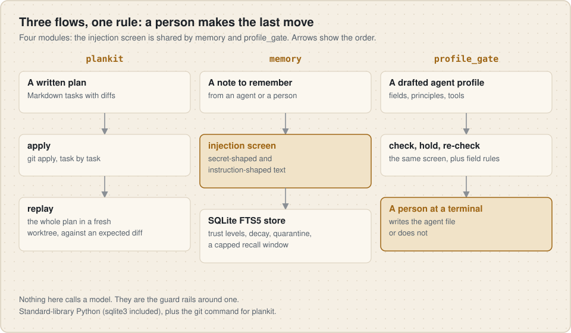

# agent-workflow

Small, tested Python tools for running coding agents against a written plan, with review gates and an advisory
memory. Standard library only.

## At a glance

- **What it is.** Four modules taken from the tooling I use to run Claude Code agents on a larger private project,
  rewritten here so they work on any git repository:
  - `plankit`: reads a Markdown plan, applies each task's diffs and new files with `git apply`, and replays a
    whole plan in a fresh worktree to check it against an expected diff. No compiler needed.
  - `memory`: an advisory memory store on SQLite FTS5, with trust levels, decay, quarantine and a capped recall
    window.
  - `injection`: a pattern screen for secret-shaped and instruction-shaped text. Its limits are listed in the module.
  - `profile_gate`: checks a drafted agent profile, holds it, re-checks it, and leaves the last step (writing the
    agent file) to a person at a terminal.
- **My part.** The design, the rules each tool enforces, the decisions and the review. See "How this was made".
- **Stack.** Python 3.12, `sqlite3` with FTS5, `git`, pytest for the tests.
- **Numbers.** 131 tests: 130 pass and 1 is skipped on Windows, where it needs the right to create symbolic
  links. Run with pytest 9.0.3 on Windows 11, 2026-11-25. The CI job on Linux runs all 131.

<picture>
  <source media="(prefers-color-scheme: dark)" srcset="diagrams/tools-dark.svg">
  
</picture>

## Install and run

Clone this repository, then from its folder:

```
python -m pip install pytest
python -m pytest -q
```

`plankit` runs as a module or, after `pip install .`, as a command:

```
python -m agent_workflow.plankit outline docs/example-plan.md
python -m agent_workflow.plankit replay docs/example-plan.md --base HEAD --expect expected.diff
```

The memory store and the profile gate are libraries:

```python
from agent_workflow.memory import Memory

m = Memory("memory.sqlite3")
m.remember(title="Replay before compile", summary="A replay finds broken hunks without a build.",
           kind="lesson", evidence="docs/playbook.md:12")
print(m.recall("replay build"))
```

## What is left out

- The private project's own plans, records, agent roles and memory contents.
- Anything that coordinates several agent sessions (leases, heartbeats, hand-overs). It depends on one machine's
  layout and is not useful on its own.
- A model. Nothing here calls one. The tools are what agents and people call.

## How this was made

Claude Code wrote most of the code, under my direction. I set the design, chose what each check must refuse, made
the decisions in `ARCHITECTURE.md`, reviewed the results and approved each change. Nothing landed until its tests
passed and a reviewer had read it. This public version is a rewrite of private tools with the project-specific parts
removed; its tests were written first and each guard was checked by removing it and watching its test fail.

## Licence

MIT. See `LICENSE`.
